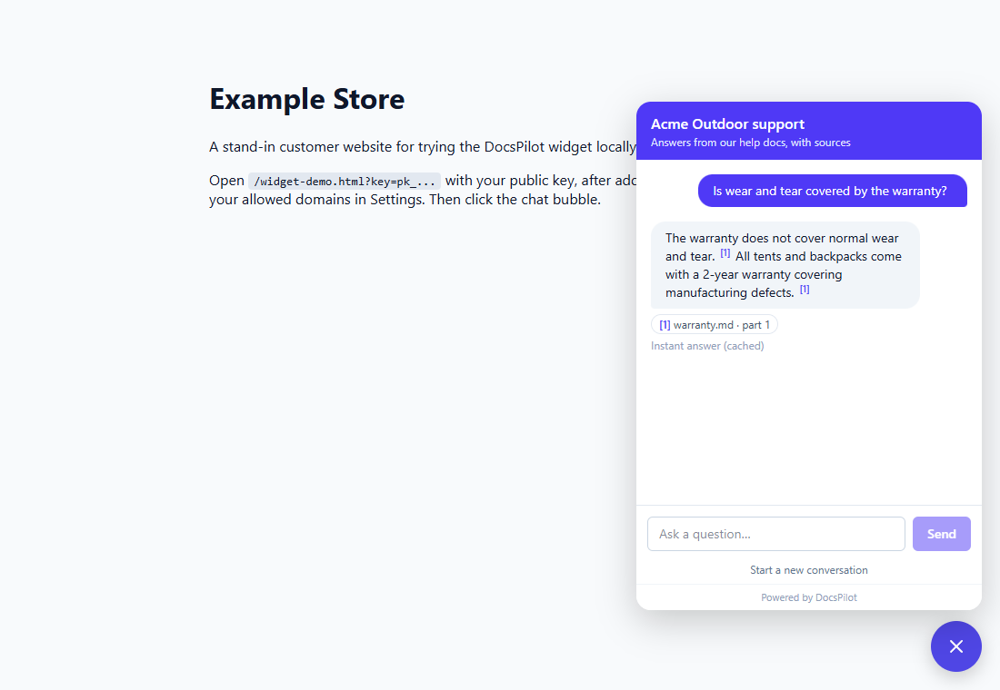
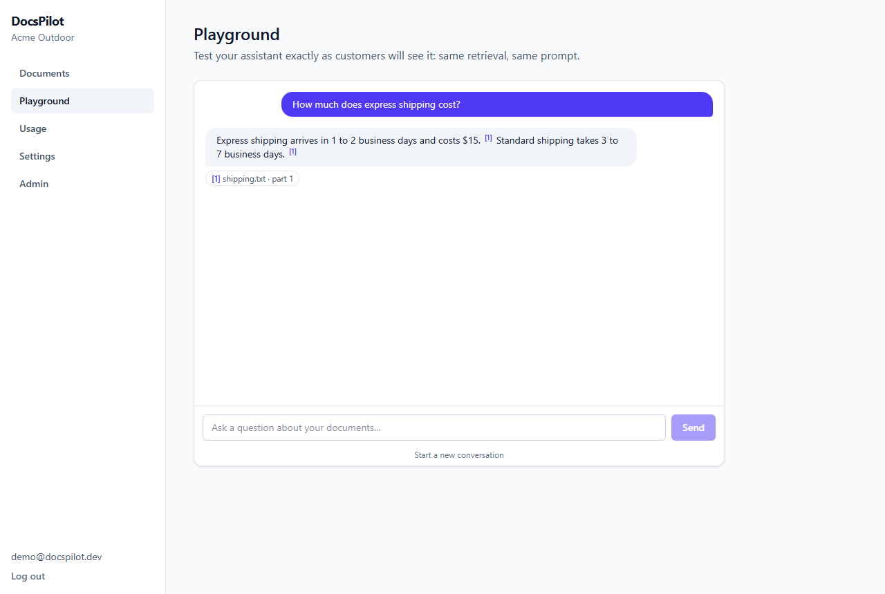
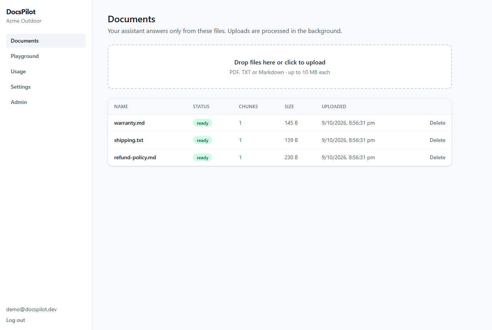
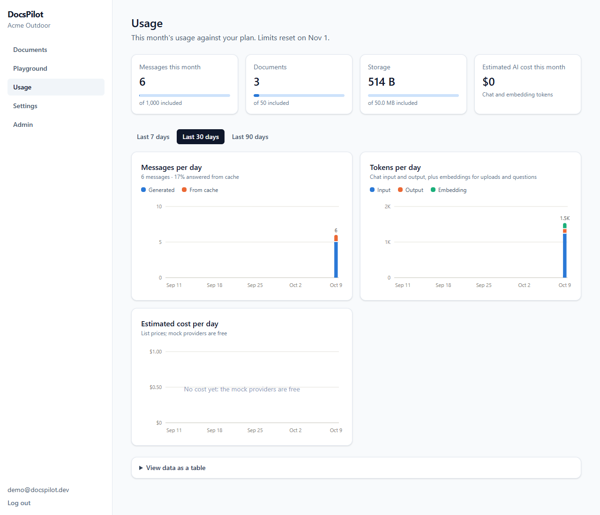
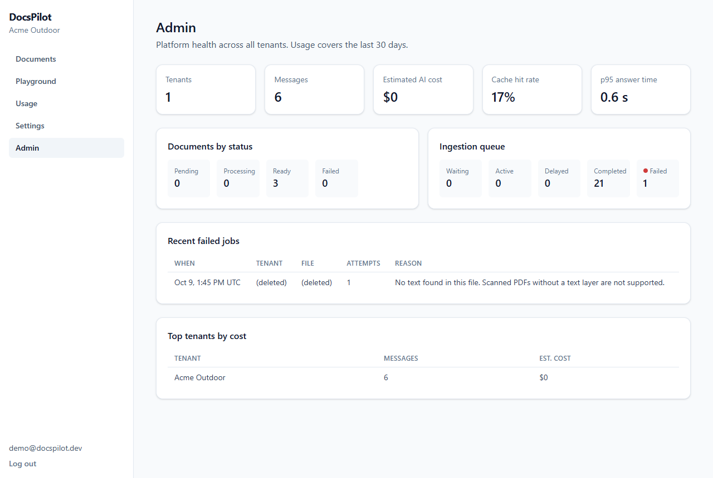

# DocsPilot

**A multi-tenant AI support assistant.** Businesses upload their documents (PDF, TXT,
Markdown) and get an embeddable chat widget that answers customer questions **using only
their own documents**, with source citations, and says *"I don't have information about
that"* instead of guessing.

Built with Next.js, Express, PostgreSQL + pgvector, Redis, BullMQ and Claude, as a
portfolio project with production concerns: tenant isolation in the database, async
ingestion with retries, streaming, caching, rate limiting, metering and observability.

**Live demo:** https://docspilot.vercel.app (Vercel + Neon + Upstash, free mock AI
providers; see [docs/DEPLOYMENT.md](docs/DEPLOYMENT.md)). It also runs locally with one
command, and free by default (no API keys needed).



| Playground | Documents |
|---|---|
|  |  |
| **Usage & limits** | **Admin** |
|  |  |

## Features

- **RAG chat with citations:** questions are embedded, matched against the tenant's chunks
  in pgvector (HNSW), and answered by Claude from numbered excerpts. Answers cite `[1]`
  sources, and nothing relevant means a fixed "no information" reply with no LLM call.
- **Streaming:** tokens stream over Server-Sent Events from Claude → Express → browser
  (first token in ~80 ms locally).
- **Multi-tenancy in the database:** Postgres Row-Level Security filters every query by
  tenant, so even a query missing `WHERE tenant_id` can't leak data. Tests prove it.
- **Async ingestion:** uploads return `202`; a BullMQ worker extracts, chunks (500 tokens,
  15% overlap), embeds and stores them. Exponential-backoff retries, idempotent jobs, and
  live status in the dashboard.
- **Embeddable widget:** one `<script data-key="pk_…">` tag. The browser only lets the
  widget appear on the tenant's allowed domains (CSP `frame-ancestors`), and the API checks
  the domain again.
- **Redis, used three ways:** sliding-window rate limits (per IP and per tenant, one atomic
  Lua script), an answer cache invalidated instantly when documents change, and the job
  queue.
- **Metering and limits:** tokens, estimated cost, latency and cache hit/miss for every
  call; monthly message, document and storage limits (`402` when exceeded); usage charts.
- **Observability:** JSON logs with request and tenant IDs, `/health`, Prometheus
  `/metrics`, and an admin page (queue depth, failed jobs, top tenants).
- **Swappable AI providers:** Claude and Voyage behind small interfaces, plus free offline
  mocks, so it runs and tests with no API keys.

## Tech stack

| Layer | Tech |
|---|---|
| Frontend | Next.js 16 (App Router), TypeScript, Tailwind CSS 4 |
| Backend | Node.js 22, Express 5, TypeScript, zod |
| Data | PostgreSQL 17 + pgvector (HNSW), `pg` with plain SQL migrations |
| Queue / cache | Redis 7, BullMQ |
| AI | Claude (`@anthropic-ai/sdk`, streaming), Voyage AI embeddings (`voyage-4`), offline mocks |
| Testing | Vitest + Supertest (115 tests against real Postgres + Redis), k6 load test |
| Infra | Docker, docker compose, GitHub Actions |

## Quick start

Requires Docker.

```bash
cp .env.example .env          # works as-is: free mock AI providers
docker compose up --build     # → http://localhost:3000
```

Sign up, upload a document, then ask about it in **Playground**. To try the widget: in
**Settings**, add `localhost:3000` to the allowed domains and open the demo page link.
To see **Admin**, put your sign-up email in `ADMIN_EMAILS` in `.env` and restart.

**For development** (hot reload), run only the infrastructure in Docker:

```bash
npm install
docker compose up -d postgres redis
npm run migrate
npm run dev:api      # :4000
npm run dev:worker
npm run dev:web      # :3000
```

## Environment variables

All variables are documented in [`.env.example`](.env.example). The main ones:

| Variable | Default | Purpose |
|---|---|---|
| `JWT_SECRET` | (required) | Signs session cookies (32+ chars) |
| `LLM_PROVIDER` | `mock` | `mock` (free, quotes your docs) or `anthropic` |
| `ANTHROPIC_API_KEY` / `CHAT_MODEL` | – / `claude-opus-5-5` | Claude key and model (`claude-haiku-5-5` is cheapest) |
| `EMBEDDING_PROVIDER` | `mock` | `mock` or `voyage` |
| `VOYAGE_API_KEY` / `VOYAGE_MODEL` | – / `voyage-4` | Voyage key (first 200M tokens free) and model |
| `RATE_LIMIT_IP_PER_MIN` / `RATE_LIMIT_TENANT_PER_MIN` | `20` / `120` | Chat rate limits |
| `CACHE_TTL_SECONDS` | `86400` | Answer cache lifetime |
| `ADMIN_EMAILS` | – | Emails allowed to open the admin page |
| `DATABASE_URL` / `REDIS_URL` | local Docker | Connection strings (set by compose in Docker) |

## Tests

```bash
docker compose up -d postgres redis
npm test             # 115 tests: real Postgres + Redis, test DB created automatically
npm run typecheck
```

Covered: tenant isolation (HTTP and direct SQL against RLS), auth and keys, ingestion
retries and idempotency (including real BullMQ retries), the RAG no-answer fallback,
citations, rate limiting, cache hit/miss and invalidation, plan limits (including parallel
uploads), widget domain checks, and metrics. CI runs typecheck, tests, builds and Docker
image builds on every push.

## Load test

[`apps/api/load/chat.k6.js`](apps/api/load/chat.k6.js): 12 virtual users for 45 s, half
asking repeated questions (cache hits) and half unique ones (misses), against the Docker
stack on a laptop with the free mock providers:

| Metric | Result |
|---|---|
| Answers | 583, **0 failed** |
| Cached answer, p95 | **73 ms** (avg 35 ms) |
| Generated answer, p95 | 740 ms (mostly the mock's deliberate 25 ms-per-word typing effect) |
| Cache hit ratio (`/metrics`) | 0.51 |

A longer run hit `402 PLAN_LIMIT_REACHED` after the tenant's 1,000 monthly messages,
which is the quota working. 1,006 got through rather than exactly 1,000, because the message
quota is a soft limit checked before each answer (document limits are exact).

## Design decisions

- **Postgres + pgvector, not a separate vector database:** vectors live next to their
  documents. One backup, one transaction to replace a document's chunks, and the same
  Row-Level Security for both.
- **Row-Level Security for tenancy:** the database enforces isolation, so a bug in one
  query can't leak another tenant's data.
- **Background ingestion with BullMQ:** uploads stay instant; jobs survive crashes, retry
  temporary failures with backoff, and fail fast on permanent ones (like a scanned PDF).
- **Two layers against hallucination:** a similarity threshold blocks irrelevant questions
  before any model call, and the prompt requires an exact "no information" phrase.
- **SSE, not WebSockets:** tokens only flow server → browser, and SSE is plain HTTP.
- **One origin:** Next.js proxies `/api/*` to Express, so cookies are first-party and no
  CORS is needed; the API stays private.
- **Versioned cache keys:** the tenant's document version is part of the key, so any
  document change invalidates every cached answer instantly.
- **Free by default:** offline mock providers make the whole app run and test without API
  keys; switching to Claude and Voyage is two env vars.

More detail: [docs/AI_AND_RAG.md](docs/AI_AND_RAG.md) (how RAG works here) ·
[docs/ARCHITECTURE.md](docs/ARCHITECTURE.md) (system design and tradeoffs) ·
[docs/DEPLOYMENT.md](docs/DEPLOYMENT.md).

## Project structure

```
apps/api     Express API + BullMQ worker (src/worker.ts), SQL migrations, tests, k6 script
apps/web     Next.js dashboard, /widget page, public/widget.js
docs         AI_AND_RAG.md, ARCHITECTURE.md, DEPLOYMENT.md, screenshots
```
