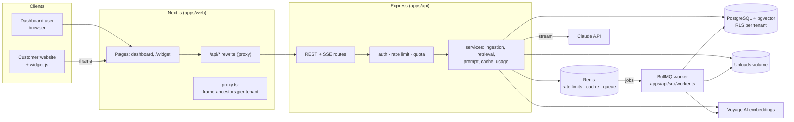
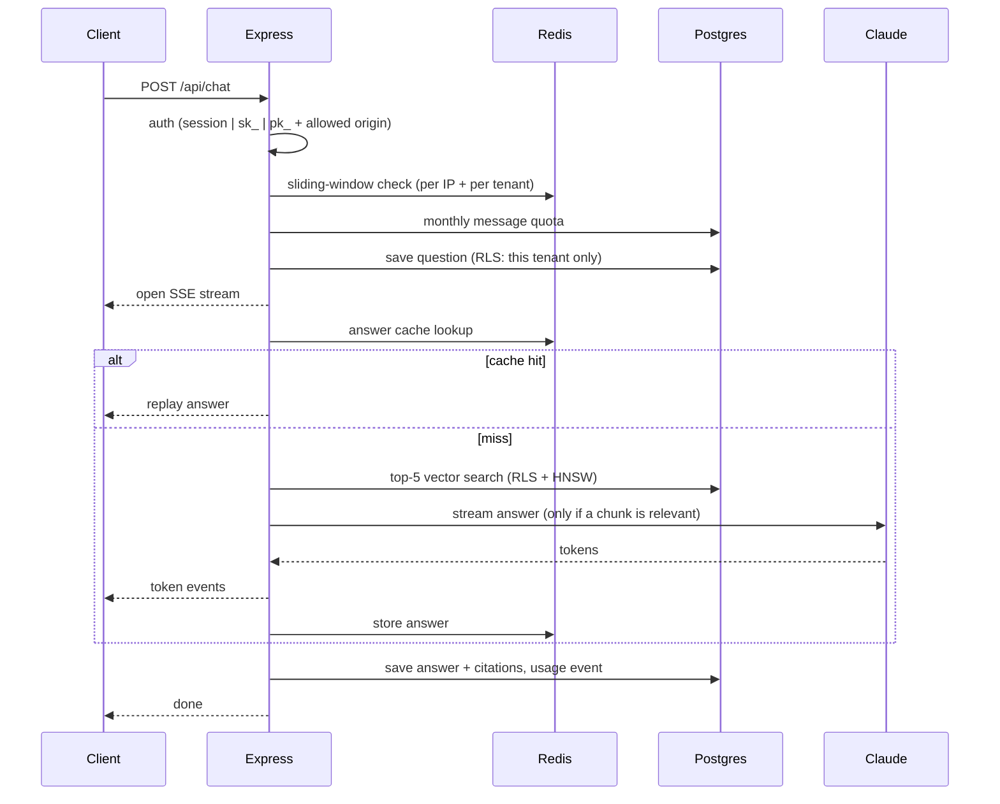
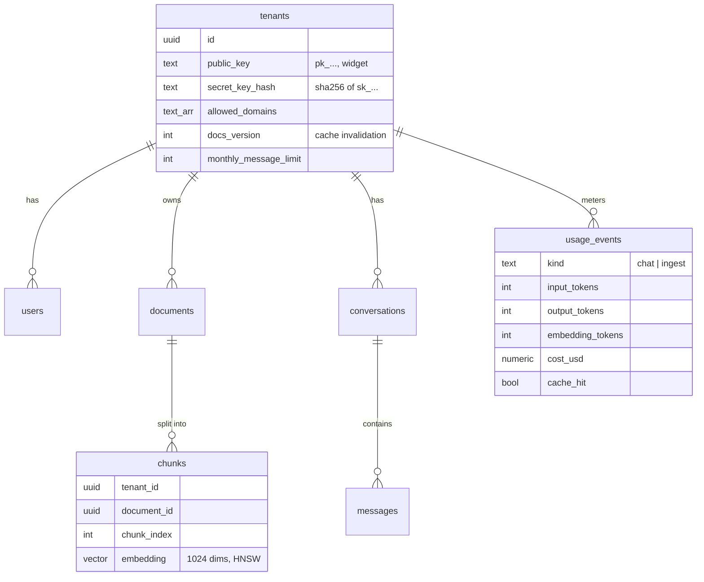

# Architecture

DocsPilot is a multi-tenant RAG support assistant: businesses upload documents, and their
customers chat with an assistant (dashboard playground or embeddable widget) that answers
only from those documents, with citations. For the AI/RAG internals see
[AI_AND_RAG.md](AI_AND_RAG.md).

## System diagram

## Components

| Component | Responsibility |
|---|---|
| **Next.js web** ([apps/web](../apps/web)) | Dashboard (login, documents, playground, usage, settings, admin) and the `/widget` page shown inside the iframe. Proxies `/api/*` to Express so the browser talks to one origin. `proxy.ts` sets the widget's `frame-ancestors` from the tenant's allowed domains. |
| **widget.js** ([public/widget.js](../apps/web/public/widget.js)) | ~100 lines of dependency-free JS: a floating button that opens the `/widget` iframe. |
| **Express API** ([apps/api](../apps/api)) | Auth (cookie JWT, secret keys, public widget keys), tenant settings, uploads, SSE chat, usage, admin, `/health`, `/metrics`. Validates every input with zod and returns one JSON error shape. |
| **Worker** ([worker.ts](../apps/api/src/worker.ts)) | Separate process, same codebase. Consumes BullMQ ingestion jobs: extract, chunk, embed, store. Retries with backoff. |
| **PostgreSQL + pgvector** | All relational data *and* the vectors. Row-Level Security isolates tenants. HNSW index for similarity search. |
| **Redis** | Exactly three jobs: sliding-window rate limits, the answer cache, and the BullMQ queue. |
| **Providers** ([providers/](../apps/api/src/providers)) | `LLMProvider` (Claude or a free mock) and `EmbeddingProvider` (Voyage or a free mock) behind small interfaces. |

## Request lifecycles

**Asking a question** (dashboard, API key, or widget):

**Uploading a document:** `POST /api/documents` validates the file (type, size, PDF magic
bytes), checks plan limits under a row lock, saves the file, inserts a `pending` row, and
enqueues a job (job ID = document ID), then returns `202 Accepted`. The worker picks the job
up and the dashboard polls the status until it's `ready` or `failed`.

## Data model

Seven tables. API keys and plan limits are columns on `tenants`, which avoids extra tables.

## Multi-tenancy and security

- **Row-Level Security.** Every table carries `tenant_id`. Tenant requests run inside
  `withTenant()`, a transaction that switches to a restricted `docspilot_tenant` role and
  sets `app.tenant_id` with `SET LOCAL`. Postgres policies then filter every row, so a query
  that forgets `WHERE tenant_id` still can't leak data. Column-level grants stop a tenant
  from raising its own plan limits. Tests disable RLS to prove they would catch a leak.
- **Three credentials:** an httpOnly + SameSite=Lax JWT cookie for the dashboard; a secret
  key (`sk_`, stored as SHA-256) for servers; a public widget key (`pk_`) that can only chat,
  only from allowed domains.
- **Framing:** the dashboard sends `frame-ancestors 'none'` (no clickjacking). The widget
  page gets a per-tenant `frame-ancestors` list, so browsers refuse to show it on other sites.
- **No CORS on the API:** browsers can only reach it through our own origin.

## Why these technologies

| Choice | Why | Alternative considered |
|---|---|---|
| **Postgres + pgvector** | One database for relational data and vectors: one backup, one transaction for "replace a document's chunks", and the same RLS for both. Plenty fast at this scale with HNSW. | A separate vector DB (Pinecone, Qdrant): another system to run, sync and secure. |
| **Redis** | Atomic, in-memory counters for rate limits (a Lua script), a TTL cache, and BullMQ's backing store: three jobs, one dependency. | Postgres for all three: works, but adds load to the primary database on every request. |
| **BullMQ** | Durable jobs, retries with exponential backoff, job IDs for de-duplication, failed-job inspection, and it's built on Redis we already run. | Doing ingestion inside the request: slow uploads, no retries, lost work on crash. |
| **SSE** | One-way server → browser streaming over plain HTTP: works through proxies and needs no special server. Tokens only flow one way, so WebSockets would add complexity for nothing. | WebSockets; long polling. |
| **Next.js rewrite to Express** | The browser sees one origin: first-party cookies, no CORS, and the API stays private. | CORS with credentials; an API gateway. |
| **`pg` + plain SQL** | Vector queries, RLS and `unnest` bulk inserts are clearest as SQL. Migrations are numbered `.sql` files applied once, in a transaction, under an advisory lock. | An ORM: hides exactly the SQL this project needs to show. |

## Observability

- **Logs:** pino JSON lines with `requestId` (also returned as `x-request-id`), `tenantId`,
  status and `durationMs` for every request; pretty-printed only in local dev.
- **`GET /health`:** checks Postgres and Redis with timeouts; returns 200 or 503.
- **`GET /metrics`** (Prometheus text format): request counts by status class, 5xx errors,
  p95 request and answer duration, cache hit ratio, queue depth by state. Like `/health`
  it's outside `/api`, so the public proxy never exposes it.
- **Admin page:** cross-tenant totals, queue counts, recent failed jobs with reasons, top
  tenants by cost. Only for emails in `ADMIN_EMAILS`.

## Key tradeoffs

- **The app connects as the table owner and drops privileges per transaction.** That's
  simple, and every query is parameterized, but for production hardening the app should
  connect as a separate non-owner role.
- **Stateless JWT sessions:** no session store, but logout can't revoke a stolen token
  before it expires (7 days).
- **Each question is answered independently** (no history to the model): grounded and
  cache-friendly, but follow-ups must be self-contained.
- **Redis is shared by queue and cache with `noeviction`** (BullMQ needs it), so cache
  memory is reclaimed by TTL only. A separate Redis for the cache removes that coupling.
- **Rate limiting and caching fail open:** a Redis outage degrades protection, not
  availability.
- **Metrics are per process:** with several API instances, Prometheus scrapes each one.
- **Local-disk uploads** behind a 3-function storage module: easy to swap for S3; the API
  and worker must share the volume until then.
